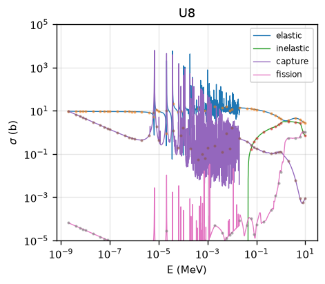
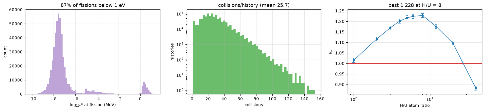
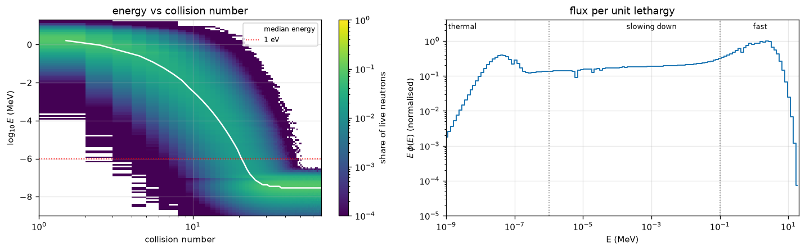
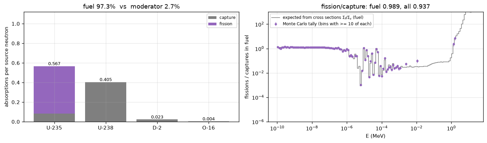

# Monte Carlo simulation of reactor criticality

Analog Monte Carlo neutron simulations of four **infinite homogeneous reactors**, using real
energy-dependent cross sections (ENDF/B-VIII.0) downloaded from KAERI. Each notebook follows
10⁶ neutrons from birth to absorption, estimates the infinite multiplication factor k∞, and shows
with graphs why a mixture can or cannot sustain a chain reaction.

| | System | k∞ (10⁶ neutrons, ±2σ) | Can go critical? | Open |
|---|---|---|---|---|
| Q1 | Pure U-238 | 0.4138 ± 0.0018 | no | [](https://colab.research.google.com/github/mohammedr3za/monte-carlo-simulation-reactor-physics/blob/main/notebooks/Q1_pure_U238.ipynb) |
| Q2 | Natural uranium | 0.5107 ± 0.0020 | no | [](https://colab.research.google.com/github/mohammedr3za/monte-carlo-simulation-reactor-physics/blob/main/notebooks/Q2_natural_uranium.ipynb) |
| Q3 | 2% enriched uranium + light water (H/U = 5) | 1.2206 ± 0.0024 | yes | [](https://colab.research.google.com/github/mohammedr3za/monte-carlo-simulation-reactor-physics/blob/main/notebooks/Q3_enriched_uranium_light_water.ipynb) |
| Q4 | Natural uranium + heavy water (D/U = 400) | 1.1684 ± 0.0024 | yes | [](https://colab.research.google.com/github/mohammedr3za/monte-carlo-simulation-reactor-physics/blob/main/notebooks/Q4_natural_uranium_heavy_water.ipynb) |

Every verdict is at least 139 standard errors from k∞ = 1. Q1 was also run with 10⁹ neutrons:
k∞ = 0.41518 ± 0.00006.

## Why the four come out this way

1. **U-238 alone fails.** It only fissions above about 1 MeV, and every collision moves a
   neutron *down* in energy. The median energy at fission is 2.56 MeV; a history ends in capture
   after about 39 collisions.
2. **Natural uranium still fails**, even though η (neutrons out per neutron absorbed) is 1.35 at
   thermal energy. Neutrons never get there: uranium is so heavy (ξ = 0.0084) that thermalising
   takes ~2200 collisions, while capture ends a history after ~37. 0.00% of fissions happen below
   1 eV. This is the result that says you need a moderator.
3. **Light water + 2% enrichment works.** Hydrogen thermalises a neutron in ~18 collisions, so 87%
   of fissions now happen below 1 eV, and the extra U-235 outweighs hydrogen's own capture and
   U-238 resonance absorption. k∞ peaks at H/U ≈ 8 (1.228) and is above 1 from H/U = 1 to 20.
4. **Heavy water works with natural uranium.** Deuterium captures about 650 times less than
   hydrogen at thermal energy, so the moderator barely competes with the fuel: 99.6% of fissions are
   below 1 eV, at the price of ~330 collisions per history. k∞ peaks near D/U ≈ 700 (1.174).

| | |
|---|---|
|  |  |
| **U-238 cross sections** from the pointwise data; dots are the 50-point table. | **Q3:** where fissions happen, collisions per history, and k∞ against the H/U ratio. |
|  |  |
| **Q3:** neutron energy against collision number, and the flux spectrum (fission peak, 1/E plateau, thermal peak). | **Q4:** what absorbs the neutrons, and the fission-to-capture ratio against energy. |

## Quick start

**In the browser, no install:** click a Colab badge above, then *Runtime → Run all*. The first run
downloads the cross sections it needs from KAERI (about 25 MB for all four notebooks).

**Locally:**

```bash
git clone https://github.com/mohammedr3za/monte-carlo-simulation-reactor-physics.git
cd monte-carlo-simulation-reactor-physics
python3 -m venv .venv && source .venv/bin/activate
pip install -r requirements.txt
jupyter lab notebooks/
```

**All four at once, headless:**

```bash
python3 scripts/run_notebooks.py     # executed notebooks + every plot, saved in results/
python3 scripts/build_report.py      # results/report.docx: a short report with all plots and numbers
```

| Notebook | Run time (one laptop core) |
|---|---|
| Q1, Q2, Q3 | about 2 minutes each |
| Q4 | about 15–20 minutes (heavy water needs ~330 collisions per neutron) |
| 10⁹ neutrons (`RUN_1E9 = True`, section 11) | Q1: 34 minutes on 8 processes. Each notebook prints its own estimate first. |

## What each notebook does

All four notebooks are the same program with a different composition, in 18 sections:

| Section | Content |
|---|---|
| 1–4 | Constants, the 50-point energy grid, downloading and interpolating the cross sections (log-log), and writing the 50-point table to `xs_<nuclide>_Q<n>.csv` |
| 5 | **Plot 1** — cross sections of every nuclide |
| 6–7 | Composition (atom ratios) and the neutron birth spectrum |
| 8 | **Plot 2** — sampled birth energies against s(E) |
| 9 | Elastic and inelastic scattering, thermal cutoff |
| 10 | Transport one neutron at a time, written as the 7-step collision procedure (easy to read, slow) |
| 11 | The same physics vectorised — 10⁶ neutrons (and the optional 10⁹ run, in parallel) |
| 12 | **Plot 3** — k∞ against the number of neutrons, and the 1/√N error |
| 13 | **Plot 4** — energy at fission, collisions per history, and η(E) (Q1, Q2) or a moderator-ratio sweep (Q3, Q4) |
| 14 | **Plot 5** — slowing down: energy against collision number, and the flux spectrum E·φ(E) |
| 15 | **Plot 6** — neutron lifetimes, split into fast (> 0.1 MeV), slowing down (1 eV–0.1 MeV) and thermal (< 1 eV) |
| 16 | **Plot 7** — absorption in fuel vs moderator, and the fission-to-capture ratio against energy |
| 17 | Sensitivity: the whole simulation re-run on only the 50-point grid |
| 18 | Conclusion |

## Method

- **Infinite medium.** No leakage, so no geometry, positions or directions — a neutron's fate
  depends only on its energy. Every decision is a ratio of cross sections, so only atom *ratios*
  matter, never absolute densities.
- **Birth.** Energy sampled from s(E) = 0.771 √E e^(−0.776E) (E in MeV), which is exactly a
  Gamma(3/2, 1/0.776 MeV) distribution, so it is sampled directly.
- **Each collision.** Pick the nuclide with probability N_i σ_t,i / Σ_t, then the reaction with
  probability σ_x / σ_t. Elastic: E′ = E[α + (1 − α)ξ], α = ((A − 1)/(A + 1))². Inelastic: subtract
  an excited level of the struck nucleus, chosen uniformly from those below E. Capture or fission
  ends the history.
- **Thermal cutoff.** Below 0.1 eV the energy is resampled from a 293 K Maxwellian, so moderated
  neutrons stop slowing down at room temperature.
- **Estimator.** k∞ = ν × fissions / N with ν = 2.42, and σ_k = ν √(p(1 − p)/N), p = fissions/N.
  In an infinite medium one generation is enough.
- **Lifetimes** are the only place absolute densities enter: uranium metal (19.05 g/cm³) mixed
  with water (H₂O 1.00, D₂O 1.105 g/cm³), volumes additive. k∞ does not depend on them.

## Cross-section data

Pointwise ENDF/B-VIII.0 data come from the KAERI Nuclear Data Center's chart of nuclides
(https://atom.kaeri.re.kr/nuchart/), through this endpoint:

    https://atom.kaeri.re.kr/nuchart/getData.jsp?target=endfb8.0,<Z>,<A>,<MAT>,3,<MT>

| | U-235 | U-238 | H-1 | D-2 | O-16 |
|---|---|---|---|---|---|
| MAT | 9228 | 9237 | 125 | 128 | 825 |

MT = 2 elastic, 4 inelastic, 102 capture, 18 fission. Files are cached as `kaeri_<nuclide>_<MT>.txt`
in the working directory and reused. Thermal (0.0253 eV) checks against published values:

| | Computed | Published |
|---|---|---|
| U-235 fission | 586.6 b | 585 b |
| U-235 capture | 99.4 b | 99 b |
| U-238 capture | 2.683 b | 2.68 b |
| H-1 capture | 0.3326 b | 0.3326 b |
| O-16 elastic | 3.92 b | 3.85 b |

The data are Doppler-broadened at about 293 K, so resonance peaks are lower than 0 K tables
(the 6.67 eV U-238 capture peak is 7135 b here).

## Adapting it

- **Different mixture:** edit section 6 — `COMP` (Q1, Q2) or `mix(enr=..., ratio=...)` (Q3, Q4).
- **Another nuclide:** add it to `ZAM` (Z, A, ENDF MAT number) and `HAVE` (which reactions it has)
  in section 3, `AMASS` in section 6, and its excited levels to `LEVELS` in section 9.
- **More or fewer neutrons:** the argument of `run(...)` in section 11; ν is `NU` in section 1.
- The shared code is identical in all four notebooks, so copy a change to the others.

## Limitations

- Using only the 50-point grid would bias k∞ by −9.9%, −6.4%, +16.3% and +8.8% (Q1–Q4) because
  five points per decade cannot resolve the U-238 resonances, so the transport uses the full
  pointwise data.
- Inelastic energy loss is modelled by discrete nuclear levels, since the cross sections alone do
  not say how much energy is lost.
- Mixtures are homogeneous. A real fuel lattice self-shields the U-238 resonances and does better.
- Q4 assumes pure D₂O; light-water contamination brings hydrogen capture back.
- Scattering is isotropic in the centre-of-mass frame, and ν is constant.
- The single-generation estimator is exact only for an infinite medium. A finite core needs power
  iteration (fission sites of one generation as the source of the next).

## License

MIT — see [LICENSE](LICENSE). Cross-section data: ENDF/B-VIII.0, via the KAERI Nuclear Data Center.
